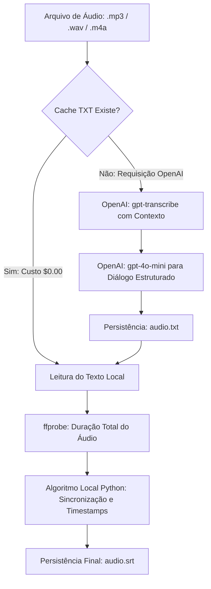

# agy-transcrever-audio

<div align="center">

[](https://www.repostatus.org/#active)
[](plugin.json)
[](https://www.python.org/)
[](https://platform.openai.com/docs/guides/speech-to-text)
[](https://peps.python.org/pep-0008/)
[](https://peps.python.org/pep-0257/)
[](LICENSE)

*Skill e plugin para Antigravity CLI e IDE para transcrição de áudio com OpenAI Whisper, identificação de múltiplos locutores e geração sincronizada de legendas SRT com proteção contra custos indevidos.*

[Visão Geral](#visao-geral) •
[Funcionalidades](#funcionalidades) •
[Arquitetura](#arquitetura) •
[Estrutura de Diretórios](#estrutura-de-diretorios) •
[Instalação](#instalacao) •
[Credenciais](#variaveis-de-ambiente) •
[Como Usar](#como-usar) •
[Parâmetros da CLI](#parametros-da-cli) •
[Padrões de Engenharia](#padroes-de-engenharia) •
[Autores](#autores-e-licenca)

</div>

---

## Visão Geral

O **agy-transcrever-audio** é uma Skill oficial para o ecossistema Antigravity / Gemini CLI projetada para transformar gravações de áudio (podcasts, entrevistas acadêmicas, reuniões e conferências) em arquivos de legenda `.srt` perfeitamente sincronizados e transcrições textuais estruturadas por interlocutor.

A solução utiliza o modelo de alta fidelidade acústica da OpenAI (`gpt-transcribe`), combinando inteligência de linguagem para formatação de turnos de fala e um algoritmo local nativo em Python para o cálculo de timestamps das legendas.

## Funcionalidades

- **Transcrição de Alta Fidelidade:** Alimentado pelo modelo `gpt-transcribe` da OpenAI com suporte a vocabulário específico, termos regionais e siglas.
- **Identificação de Múltiplos Locutores:** Rotulação clara de turnos de diálogo (ex: `[Entrevistador] Nome: fala...`).
- **Geração de Legendas SRT (Padrão):** Criação direta de legendas temporizadas no padrão SubRip (`.srt`) prontas para YouTube, Premiere, DaVinci Resolve ou reprodutores de vídeo.
- **Protocolo Obrigatório Anti-Custo:** Modo de pré-checagem (`--dry-run`) com cálculo prévio de duração e estimativa em dólares, exigindo confirmação explícita antes de qualquer requisição tarifada.
- **Cache Local Inteligente:** Reaproveitamento automático de transcrições já realizadas no diretório, permitindo gerar novas legendas com **custo $0.00**.
- **Diagnóstico Gratuito de Credenciais (`--check`):** Validação segura da API da OpenAI, dependências do sistema operacional (FFmpeg) e ambiente virtual sem gastar créditos.
- **Multiplataforma:** Suporte nativo completo para Linux, macOS e Windows (PowerShell).

## Arquitetura



### Estrutura de Diretórios

```
agy-transcrever-audio/
├── .gemini/
│   └── skills/
│       └── agy-transcrever-audio/
│           └── SKILL.md      # Manifesto da Skill e diretrizes para o agente
├── audios/                   # Pasta para arquivos de mídia locais (não versionada)
│   └── .gitkeep
├── presets/                  # Templates de contexto e participantes
│   └── modelo.json           # Template público de exemplo
├── scripts/
│   └── transcrever.py        # CLI de execução principal (100% PEP 8)
├── .env.example              # Exemplo de configuração de credenciais
├── .gitignore                # Regras estritas de privacidade e exclusão
├── AUTHORS.md                # Créditos de autoria e guia de contribuição
├── install.ps1               # Script de instalação para Windows (PowerShell)
├── install.sh                # Script de instalação para Linux / macOS
├── plugin.json               # Manifesto do plugin para Antigravity CLI
├── README.md                 # Documentação principal do repositório
└── requirements.txt          # Dependências mínimas do projeto
```

## Instalação

### 1. Pré-requisito do Sistema (FFmpeg)

Certifique-se de que o utilitário `ffmpeg` (e `ffprobe`) está instalado no seu sistema:

```bash
# Linux (Ubuntu / Debian)
sudo apt update && sudo apt install ffmpeg

# macOS (Homebrew)
brew install ffmpeg

# Windows (Winget)
winget install Gyan.FFmpeg
```

### 2. Instalação via Antigravity CLI (Recomendado)

Se você já utiliza o `agy` em qualquer sistema operacional:

```bash
agy plugin install https://github.com/marcelnishihara/agy-transcrever-audio.git
```

### 3. Instalação Manual (Git Clone)

#### No Linux / macOS:
```bash
git clone https://github.com/marcelnishihara/agy-transcrever-audio.git
cd agy-transcrever-audio
./install.sh
```

#### No Windows (PowerShell):
```powershell
git clone https://github.com/marcelnishihara/agy-transcrever-audio.git
cd agy-transcrever-audio
.\install.ps1
```

## Variáveis de Ambiente

Crie o arquivo `.env` na raiz do projeto a partir do modelo [.env.example](.env.example):

```bash
cp .env.example .env
```

| Variável | Obrigatória | Descrição |
| :--- | :---: | :--- |
| `OPENAI_API_KEY` | Sim | Chave de API secreta obtida no [OpenAI Platform](https://platform.openai.com/api-keys). |

### Verificação do Ambiente e Credenciais

Para validar suas credenciais e dependências sem custos:

```bash
python scripts/transcrever.py --check
```

## Como Usar

### ⚡ Chamada Rápida via Prompt no Chat (Slash Command)

Você pode invocar a skill diretamente na conversa com o Antigravity de forma concisa e parametrizada:

```text
/agy-transcrever-audio <audio> <preset_ou_contexto> [participantes...] [--formato srt|txt|ambos] [--output caminho]
```

#### Exemplos de Uso no Chat:

- **Usando um Preset Existente:**
  ```text
  /agy-transcrever-audio audios/episodio_01.mp3 meu_podcast
  ```
- **Informando Contexto e Participantes diretamente:**
  ```text
  /agy-transcrever-audio aula.mp3 "Aula de Física Quântica" "Professor: Fulano de Tal" "Monitor: Sicrano"
  ```
- **Listando os Presets Disponíveis:**
  ```text
  /agy-transcrever-audio --list-presets
  ```
- **Criando um Novo Preset:**
  ```text
  /agy-transcrever-audio --novo-preset historia "Aulas de História do Brasil" "Professor: Fulano"
  ```
  *(Ou em linguagem natural: "Crie um preset chamado 'historia' com o professor Fulano...")*
- **Com Saída Customizada e Formato Completo:**
  ```text
  /agy-transcrever-audio gravacao.wav "Reunião de Diretoria" "Presidente: Fulano" --formato ambos --output /saidas/reuniao.srt
  ```
- **Checagem de Credenciais e Saldo:**
  ```text
  /agy-transcrever-audio --check
  ```

---

### 💻 Execução Direta via Terminal (Linha de Comando)

Se preferir executar diretamente no terminal sem passar pelo assistente:

1. Crie seu preset a partir do modelo base:
   ```bash
   cp presets/modelo.json presets/meu_programa.json
   ```
2. Edite `presets/meu_programa.json` preenchendo o contexto temático e os participantes.
3. Execute com pré-checagem:
   ```bash
   # Simulação prévia sem custos:
   python scripts/transcrever.py --audio audios/episodio.mp3 --preset meu_programa --dry-run

   # Execução real:
   python scripts/transcrever.py --audio audios/episodio.mp3 --preset meu_programa
   ```

Para listar os presets disponíveis:
```bash
python scripts/transcrever.py --list-presets
```

### 2. Transcrição com Argumentos Diretos

Para gravações pontuais, passe os participantes e o contexto na própria linha de comando:

```bash
python scripts/transcrever.py \
  --audio /caminho/entrevista.wav \
  --contexto "Discussão sobre educação pública e tecnologias pedagógicas." \
  --participante "Entrevistador: Fulano de Tal" \
  --participante "Convidado: Sicrano da Silva" \
  --formato ambos
```

### 3. Nomenclatura e Diretório de Saída

Por padrão, a legenda `.srt` e a transcrição `.txt` são salvas **no mesmo diretório do arquivo de áudio** com o mesmo nome base:
- Entrada: `/meus_audios/gravacao.mp3`
- Saída: `/meus_audios/gravacao.srt`

Para especificar outro destino ou renomear a saída, utilize a flag `--output`:
```bash
python scripts/transcrever.py \
  --audio /meus_audios/gravacao.mp3 \
  --preset meu_programa \
  --output /minhas_legendas/episodio_01_final.srt
```

## Parâmetros da CLI

| Parâmetro | Flag Curta | Tipo | Padrão | Descrição |
| :--- | :---: | :---: | :---: | :--- |
| `--audio` | `-a` | Path | *None* | Caminho do único arquivo de áudio a ser processado. |
| `--preset` | | String | *None* | Nome ou caminho do arquivo JSON de preset. |
| `--contexto` | `-c` | String | *None* | Contexto semântico e termos específicos. |
| `--participante` | `-p` | String | `[]` | Participante no formato `'Papel: Nome'`. Repetível. |
| `--formato` | `-f` | Choice | `srt` | Formato de saída: `srt`, `txt` ou `ambos`. |
| `--output` | `-o` | Path | *None* | Destino ou nome alternativo para os arquivos de saída. |
| `--dry-run` | | Flag | `False` | Simula a execução exibindo duração e custo estimado. |
| `--check` | | Flag | `False` | Valida credenciais e dependências sem gastar créditos. |
| `--list-presets` | | Flag | `False` | Lista todos os presets de contexto disponíveis. |

## Padrões de Engenharia

- **Estilo de Código:** Aderência estrita à [PEP 8](https://peps.python.org/pep-0008/) com limite de 79 colunas por linha de código, auditado com `flake8`.
- **Documentação de Código:** Docstrings estruturadas conforme a [PEP 257](https://peps.python.org/pep-0257/).
- **Segurança de Dados:** O arquivo [.gitignore](.gitignore) impede o envio acidental de áudios brutos, legendas geradas, variáveis `.env` e arquivos JSON de presets privados.

## Autores e Licença

Consulte o arquivo [AUTHORS.md](AUTHORS.md) para detalhes sobre a autoria e guia de contribuições.

Este projeto está licenciado sob os termos da licença MIT. Consulte [LICENSE](LICENSE) para mais informações.
